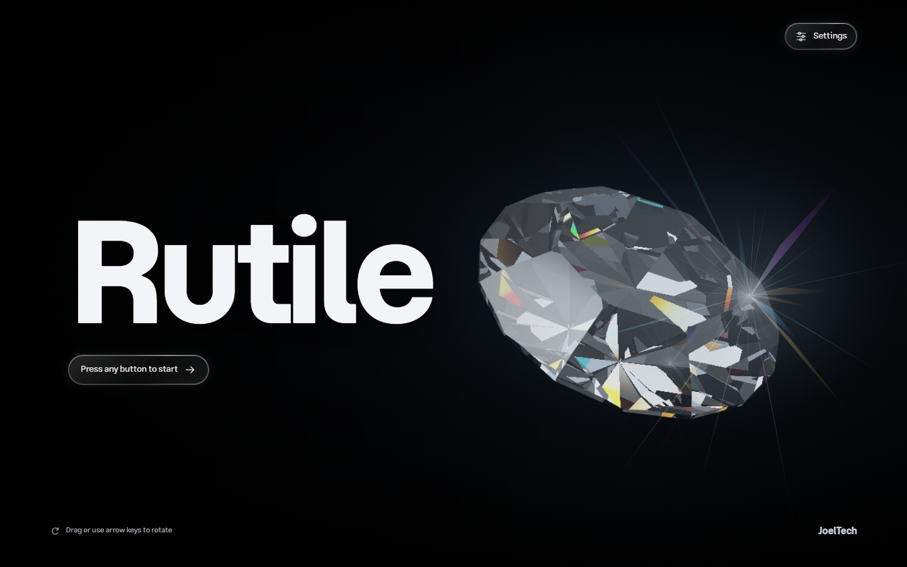
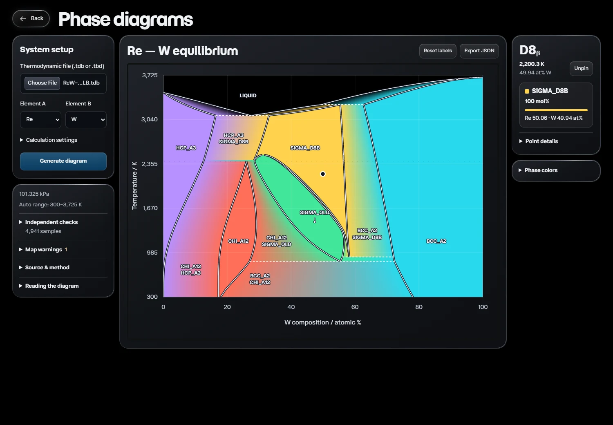

# Rutile

Rutile is a local materials modeling app for exploring phase equilibrium and
estimating properties from CALPHAD results. Generate binary phase diagrams from
thermodynamic databases or use **Alloy studio** to simulate equilibrium during
arc melting and cooling for Al-, Fe-, and Ni-based alloys. Rutile reports phase
compositions and molar amounts and provides density and modulus estimates where
the required models or references are available.



## Run locally

Install Python 3.12, then clone or download this repository and open its folder. Rutile runs on your computer, and the included examples and MatCalc family simulations run without an API key.

**Windows**

Double-click [run-rutile.cmd](run-rutile.cmd), or run it from PowerShell. The launcher sets up the environment on the first run and opens Rutile in your browser.

```powershell
.\run-rutile.cmd
```

**macOS**

Use [run-rutile.command](run-rutile.command). Once, open Terminal in the repository
folder and grant the launcher permission to run:

```sh
chmod +x run-rutile.command
```

Then double-click `run-rutile.command` in Finder. Like the Windows launcher, it
creates the Python 3.12 environment and installs dependencies on the first run,
then opens Rutile in your browser. Python 3.12 must already be installed.
You can also run `bash run-rutile.command` from Terminal, with optional arguments
such as `--port 8001`.

**Linux (or manual macOS setup)**

```sh
python3.12 -m venv .venv
.venv/bin/python -m pip install -e .
.venv/bin/python scripts/run_app.py --open
```

Keep the terminal running while you use Rutile at [127.0.0.1:8000](http://127.0.0.1:8000). Press **Ctrl+C** to stop the server.

After updating an existing checkout, refresh its dependencies from the repository
folder before restarting the server:

```powershell
.venv/Scripts/python.exe -m pip install -c requirements-win-py312.txt -e .
```

On macOS or Linux, use `.venv/bin/python -m pip install -e .`. Restart the server
and reload the browser to pick up the update.

## Alloy studio

1. Open **Alloy studio → Create alloy** and select an aluminum, iron, or nickel
   family. Choose mass percent (wt%) or atomic percent (at%) and enter the amount
   of each element. The total must be 100%. **Use balance** fills the base amount.
2. In **Processing**, set the initial annealed equilibrium temperature, fully
   mixed melt temperature, final temperature, and pressure. The bundled MatCalc
   thermodynamic assessment and its matching mobility file load by default.
3. Open **Review your alloy setup** and select **Simulate phases**. Inspect the
   initial, melt, and cooled states, the cooling path, and tracer diffusivity
   where supported. **Export phase JSON** saves the result and source provenance.

**Optimize alloy** accepts composition bounds, property goals, and limits. Its
phase simulation uses half of each addition's upper bound with the base metal
as the balance. Property optimization and calibrated strength prediction remain
planned. [Roadmap](docs/roadmap.md)

Rutile checks that the chosen melt temperature produces a fully liquid state and
samples equilibrium during cooling. The model assumes a homogeneous alloy, no
composition loss, and complete redistribution at each sampled temperature.
[Processing methods and limits](docs/processing.md)

### Bundled databases

The repository includes the Al, Fe, and Ni MatCalc thermodynamic assessments,
their matching mobility files, and the physical density database under
`data/matcalc/`. The family source and mobility companion are ready when the app
starts. The bundle retains the original files and their checksums. [Source attribution and licenses](data/matcalc/README.md)

To use a different assessment, import a TDB in **Processing**. Manual imports
use their own thermodynamic models. The named mobility companions are paired with
their family sources. Set `RUTILE_DATABASE_ROOT` to replace the default source
collection or `RUTILE_PHYSICAL_DATABASE` to select another local density file.

## Materials Project property references

Open **Settings → Materials Project**, enter your API key, and choose **Save key**.
The server holds the key in memory until restart. **Clear session key** removes
it and restores any environment key. To configure a persistent key, copy
[.env.example](.env.example) to a local `.env` file, set `MP_API_KEY`, and restart
Rutile. The standard launcher loads the file and respects an existing environment
value.

**Use local MatCalc density parameters where supported** is enabled by default
and works offline. Enable **Estimate density and modulus with Materials Project**
to use computed references where composition and structure coverage permit.
Results distinguish local model estimates, provisional phase references, optional
screening estimates, and missing coverage. [Property methods](docs/processing.md#materials-project-density-and-modulus)

## Explore Re–W

Upload the included [ReW-00Liu-LB.tdb](examples/ReW-00Liu-LB.tdb)
under **Thermodynamic file**. Choose Re and W and keep **Auto** temperature
range, **101,325 Pa**, and **Detailed** quality. The screenshot below uses Manual
limits of **300–4,000 K**. The phase-fraction gradients show
coexisting solids, with liquid always black. Small differences near a boundary
are ignored within the adjustable tolerance while their raw values remain in the
inspector and JSON export. The bundled assessment is an unmodified copy; see
[assessment attribution and license](examples/README.md#rew).



This display example has 4,929 matching checks, seven differences within the
default boundary tolerance, five unverified points, and no unresolved equilibria.
It is not experimental validation. [Calculation methods and limits](docs/phase-diagrams.md)

Many phase diagrams can also be found at [PhaseDiagrams.org](https://phasediagrams.org/).

## Try the included Al–Cu example

1. Start from the title screen and choose **Generate phase diagrams**.
2. Under **Thermodynamic file**, select the included [AlCu-21Kro.tdb](examples/AlCu-21Kro.tdb). Rutile selects Al and Cu automatically.
3. Open **Calculation settings**. Keep **Auto** temperature range or choose **Manual limits** and enter **300–1,400 K**. Leave pressure at **101,325 Pa**, and keep **Detailed** or choose **Fine** for more boundary refinement and independent checks.
4. Click **Generate diagram**. Hover near **10 atomic percent Cu** at **750 K** to inspect the Al-rich FCC phase and the Al₂Cu intermetallic. Click to pin the point or use **Export JSON** to save the calculation.

The renderer traces boundaries, shades mixed fields by molar phase amounts, and
checks independent equilibria (4,941 in Detailed, 10,201 in Fine). Auto uses ten
composition probes, so it can miss narrow melting peaks between probes. Numerical
checks do not establish experimental accuracy; published alloy benchmark
validation remains outstanding. [Calculation methods and limits](docs/phase-diagrams.md) · [Assessment and license](examples/README.md)

## Preliminary density benchmarks

Five single-FCC diagnostics agreed with published nominal densities within 0.64%
using local MatCalc parameters. The table reports the imposed FCC calculations.

| Alloy | Published nominal (g/cm³) | FCC diagnostic (g/cm³) | Difference |
|---|---:|---:|---:|
| Al 6061 | 2.700 | 2.6865 | −0.50% |
| Al 7075 | 2.800 | Unavailable: missing explicit Zn parameters | — |
| Fe 304L | 7.900 | 7.9078 | +0.10% |
| Fe 316L | 8.000 | 7.9636 | −0.45% |
| Ni INCONEL 600 | 8.470 | 8.5040 | +0.40% |
| Ni INCONEL 625 | 8.440 | 8.4942 | +0.64% |

The Fe and Ni diagnostics omit carbon and renormalize the composition because
the density model currently lacks interstitial support. Complete processed-alloy
density was unavailable for all six benchmark compositions because of phase
coverage gaps and Ni model preparation failures. The benchmark guide records the
conditions, references, and exact compositions. [Density benchmark methods](docs/density-benchmarks.md)

## Project and development

Rutile uses native HTML, CSS, and JavaScript for the interface. FastAPI manages
local requests and cancellable subprocess jobs. pycalphad calculates equilibrium
and Kawin provides supplementary tracer diffusion. Run `.venv/Scripts/python.exe
-m pytest` on Windows or `.venv/bin/python -m pytest` on macOS or Linux after
installing the development extras. [Development instructions](AGENTS.md) · [Documentation](docs/README.md)
