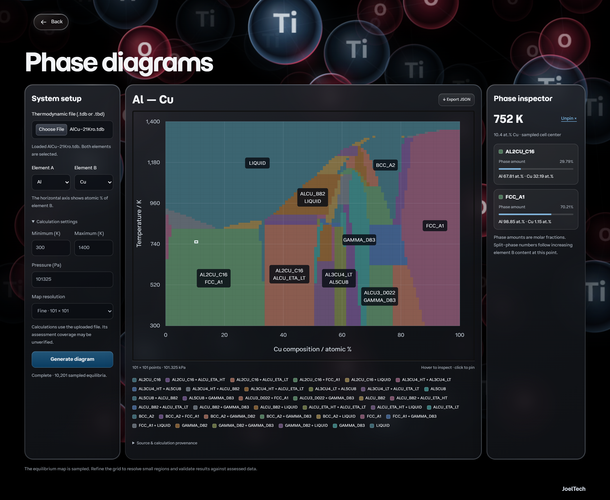
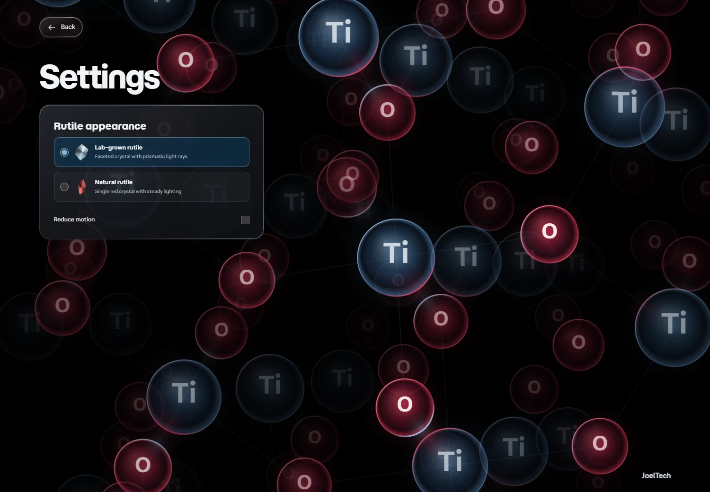

# Rutile

Rutile is a local web app for exploring how the stable phases in an alloy change with temperature and composition. Upload a thermodynamic database, choose two elements, and calculate a binary equilibrium phase diagram with pycalphad.


## What you can do

- Import a `.tdb` or `.tbd` thermodynamic database and choose two elements from it.
- Set the temperature range, fixed pressure, and grid resolution. Follow progress or cancel a running calculation.
- Inspect individual points to see which phases coexist, how much of each phase is present, and its composition.
- Export the grid, calculation settings, and source provenance as JSON.

## Run locally

Install Python 3.12, then clone or download this repository and open its folder. Rutile runs on your computer, and the included example requires no API key.

**Windows**

Double-click [run-rutile.cmd](run-rutile.cmd), or run it from PowerShell. The launcher sets up the environment on the first run and opens Rutile in your browser.

```powershell
.\run-rutile.cmd
```

**macOS or Linux**

```sh
python3.12 -m venv .venv
.venv/bin/python -m pip install -e .
.venv/bin/python scripts/run_app.py --open
```

Keep the terminal running while you use Rutile at [127.0.0.1:8000](http://127.0.0.1:8000). Press **Ctrl+C** to stop the server.

## Try the included example

1. Start from the title screen and choose **Generate phase diagrams**.
2. Under **Thermodynamic file**, select the included [AlCu-21Kro.tdb](examples/AlCu-21Kro.tdb). Rutile selects Al and Cu automatically.
3. Open **Calculation settings**. Set the temperature range to **300–1,400 K**, leave pressure at **101,325 Pa**, and choose **Fine · 101 × 101** for the map resolution.
4. Click **Generate diagram**. Hover near **10 atomic percent Cu** at **750 K** to inspect the Al-rich FCC phase and the Al₂Cu intermetallic. Click to pin the point or use **Export JSON** to save the calculation.



This run samples 10,201 equilibria from 300 to 1,400 K at 101.325 kPa using the published Al–Cu assessment. The range starts near room temperature and extends above pure copper’s melting point of about 1,358 K. Grid resolution affects how closely the map locates phase boundaries. [Assessment and license](examples/README.md) · [NIST copper phase change data](https://webbook.nist.gov/cgi/cbook.cgi?ID=C7440508&Mask=4)

## Interface

Drag the crystal on the title screen to rotate it, or use the arrow keys. Open **Settings** to switch to the natural red rutile or reduce motion. [Interface guide](docs/ui-ux.md)



## Project and development

The frontend uses HTML, CSS, and native JavaScript. FastAPI serves the interface and manages background jobs, and pycalphad calculates equilibrium. The current workflow covers binary equilibrium. The roadmap tracks published benchmark validation and future modeling features.

- [Frontend](frontend/)
- [Backend](backend/src/rutile3/)
- [Tests](backend/tests/)
- [Documentation](docs/README.md)
- [Roadmap](docs/roadmap.md)
