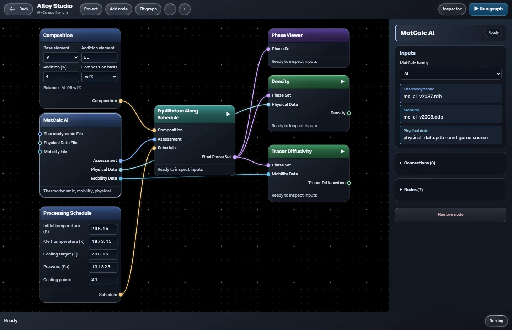
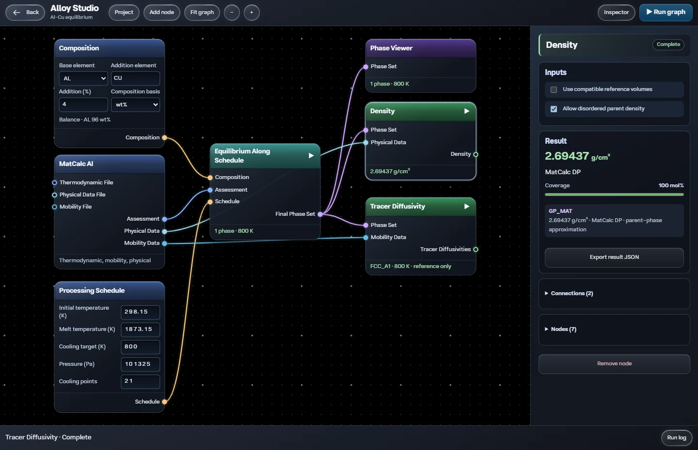

# Rutile

Rutile generates binary equilibrium phase diagrams from thermodynamic databases.
**Alloy Studio** is a full-window node editor for equilibrium during melting
and cooling, phase inspection, density, and tracer diffusion. MatCalc presets
are available for Al, Fe, Mg, Mo, Ni, and Ti.


## Setup and run

Install Python 3.12, then clone or download this repository and open its folder.
Rutile runs locally. The included phase diagrams, MatCalc equilibrium simulations,
and supported offline property estimates are available without a Materials
Project API key.

**Windows**

Double-click [run-rutile.cmd](run-rutile.cmd), or run it from PowerShell. The launcher sets up the environment on the first run and opens Rutile in your browser.

```powershell
.\run-rutile.cmd
```

**macOS**

Use [run-rutile.command](run-rutile.command). Once, open Terminal in the repository
folder and grant the launcher permission to run:

```sh
chmod +x run-rutile.command
```

Then double-click `run-rutile.command` in Finder. Like the Windows launcher, it
creates the Python 3.12 environment and installs dependencies on the first run,
then opens Rutile in your browser. Python 3.12 must already be installed.
You can also run `bash run-rutile.command` from Terminal, with arguments
like `--port 8001` if you want to.

**Linux (or manual macOS setup)**

```sh
python3.12 -m venv .venv
.venv/bin/python -m pip install -e .
.venv/bin/python scripts/run_app.py --open
```

Keep the terminal running while you use Rutile at [127.0.0.1:8000](http://127.0.0.1:8000).

After updating an existing checkout, refresh its dependencies from the repository
folder before restarting the server:

```powershell
.venv/Scripts/python.exe -m pip install -c requirements-win-py312.txt -e .
```

On macOS or Linux, use `.venv/bin/python -m pip install -e .`. Restart the server
and reload the browser to pick up the update.

## Alloy Studio

Open **Alloy Studio** to edit the prewired Al–4 wt% Cu graph. Enter values
directly on **Composition**. Click **Edit schedule** on **Processing Schedule**
to edit the thermal events in the Inspector and see the updated chart.
The starter has separate **Thermodynamic File**, **Mobility File**, and
**Physical Data File** inputs preconfigured with MatCalc files. File and
**Phase Data** inputs appear as compact pills. Select a pill to edit it.



Right-click the canvas to add a node. Drag from either end of a wire into
open space to search for compatible nodes and connect your selection. Starting
from an input shows nodes that can supply it. The wire snaps to compatible
pins on existing nodes. Select a node and press
**X**, **Delete**, or **Backspace** to remove it. Right-click a wire to
disconnect it or double-click it to add a draggable reroute dot. Use
**Project** to open the starter, start a blank workflow, or import and export
`.rutile` files.

Open **Project → Al–Cu starter** for the casting and aging branches of
Al–4 wt% Cu. **Run graph** runs connected calculations with ready inputs.
**Equilibrium Along Schedule** outputs a **Phase Set**. **Phase Assignment**
turns it into a **Final Phase Set** with available reference and property data.
It shows up to five phases on the canvas and every phase in the Inspector.
Enter a Materials Project ID or material-page link on a **Phase Data** node.
The same node can carry sourced local properties.
**Phase Viewer** shows amounts in mol%, compositions in at%, and attached
properties. **Density and Elasticity** reports per-phase coverage, and **Tracer Diffusivity**
identifies the evaluated phase and temperature.

Casting equilibrium feeds **Scheil Solidification** and **Spectral Color**.
The starter includes runnable θ′ kinetics for 168 h of aging at 453 K and a separate
published microstructure for the **Microstructure Viewer** and **Aluminum Mechanical
Properties**. **Run graph** calculates proof stress and Vickers hardness with the
bundled calibration. Use the Inspectors to change the inputs for another material condition.
[Aluminum models and data requirements](docs/aluminum-family-modeling.md)



In this earlier run, the cooling target was set to **800 K** and
**Allow disordered parent density** was enabled on Density and Elasticity. The Inspector
labels the linked-parent approximation and shows the coverage for that run.
[Canvas controls](docs/ui-ux.md#alloy-studio-workflows) · [Processing methods](docs/processing.md)

### Research missing phase properties

1. Install Codex locally and sign in. In **Settings → Research agents**, check
   that Rutile finds the executable or save its full path.
2. Run **Phase Assignment**, then open **Find missing data** in the Inspector.
   Select any missing density and elasticity targets and choose **Start Codex
   research**. Rutile starts Codex, connects the bundled MCP, and sends the task.
3. Follow agent replies, tool activity, and target progress in the widescreen
   research view. When the host reports usage, the view also shows output
   tokens and their average rate. Review the findings and choose **Apply and
   rerun** to use selected values with the saved equilibrium.

To use a separate Codex chat, select **Install Rutile MCP in Codex** in
Settings. For another stdio MCP client, prepare and copy the connector
configuration there. Choose **Manual MCP handoff** in Alloy Studio, then copy
and send the task from the research view. Settings also accepts custom Pi RPC
and Codex App Server launchers for automatic handoff. [Reference research setup](docs/reference-research.md)

### Bundled databases

The repository includes Al, Fe, Mg, Mo, Ni, and Ti MatCalc thermodynamic assessments,
their matching mobility files, and the physical density database under
`data/matcalc/`. The family source and mobility companion are ready when the app
starts. The bundle retains the original files and their checksums. [Source attribution and licenses](data/matcalc/README.md)

Choose a preset or upload a custom file in each file node's Inspector.
**Thermodynamic File** connects to Equilibrium, **Physical Data File** connects
to Phase Assignment, and **Mobility File** connects to Tracer Diffusivity.
Tracer calculations require a mobility file compatible with the selected
assessment. Set `RUTILE_DATABASE_ROOT` to replace the default source
collection or `RUTILE_PHYSICAL_DATABASE` to select another local density file.

## Materials Project property references

Open **Settings → Materials Project**, enter your API key, and choose **Save key**.
Rutile saves `MP_API_KEY` in its Git-ignored local `.env` and uses it immediately.
**Clear saved key** removes the entry and restores any process environment key.
You can also set the variable directly in your environment or in the local file.

In Alloy Studio, **Density** uses local MatCalc physical data when its source
is connected and applicable. **Use compatible reference volumes** also allows
phase-matched Materials Project references, including compatible bundled
records available offline. In guided setup, live stiffness tensor lookup
requires an API key. Results show the source and coverage of each estimate.
[Property methods](docs/processing.md#materials-project-density-and-modulus)

## Try the included refractory phase diagram

Upload the included [ReW-00Liu-LB.tdb](examples/ReW-00Liu-LB.tdb)
under **Thermodynamic file**. Rutile selects Re and W automatically. Keep the
**Auto** temperature range, **101,325 Pa**, and **Detailed** quality. The
gradients show molar phase amounts in coexisting regions. Liquid is black.
When the continuation solver falls back to hull mapping, the Gibbs-energy hull
supplies candidate regions and pycalphad solves their coexistence boundaries.
Detailed quality runs 4,941 independent equilibrium checks. Red crosses mark
disagreements with the mapped boundaries.


An Auto run resolved 300–3,725 K. Of its 4,941 checks, 4,936 agreed and five
were within the boundary tolerance. One unresolved temperature slice left
the map partially verified. The screenshot uses Manual limits of 300–4,000 K.
[Calculation methods and limits](docs/phase-diagrams.md)

## Density benchmarks

In the November 2026 benchmark, five imposed single-FCC calculations agreed
with published nominal densities within 0.64% using local MatCalc parameters.

| Alloy | Published nominal (g/cm³) | FCC diagnostic (g/cm³) | Difference |
|---|---:|---:|---:|
| Al 6061 | 2.700 | 2.6865 | −0.50% |
| Fe 304L | 7.900 | 7.9078 | +0.10% |
| Fe 316L | 8.000 | 7.9636 | −0.45% |
| Ni INCONEL 600 | 8.470 | 8.5040 | +0.40% |
| Ni INCONEL 625 | 8.440 | 8.4942 | +0.64% |

The Fe and Ni diagnostics omitted carbon and renormalized the remaining
composition. The 7075 FCC diagnostic lacked an explicit Zn density endmember.
The benchmark guide records these assumptions, the equilibrium runs, and the
nominal references. [Density benchmark methods](docs/density-benchmarks.md)
