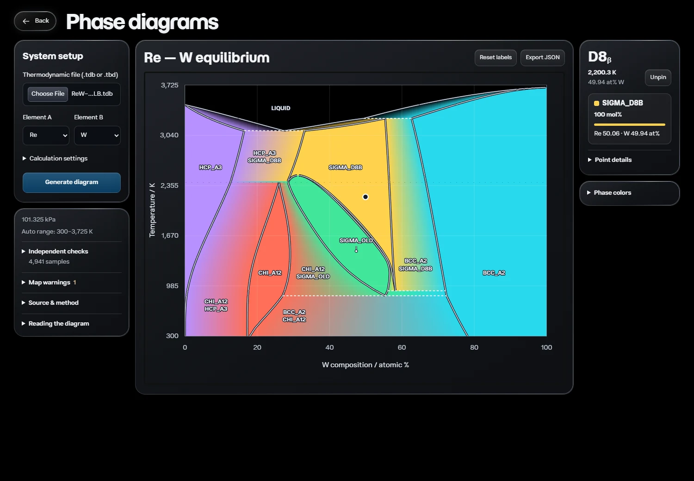

# Rutile

Rutile generates binary equilibrium phase diagrams from thermodynamic databases.
**Alloy studio** simulates equilibrium during melting and cooling for Al-, Fe-,
and Ni-based alloys, estimates density and elastic properties where data
support them, and analyzes measured tensile curves.


## Setup and run

Install Python 3.12, then clone or download this repository and open its folder.
Rutile runs locally. The included phase diagrams, MatCalc equilibrium simulations,
and supported offline property estimates are available without a Materials
Project API key.

**Windows**

Double-click [run-rutile.cmd](run-rutile.cmd), or run it from PowerShell. The launcher sets up the environment on the first run and opens Rutile in your browser.

```powershell
.\run-rutile.cmd
```

**macOS**

Use [run-rutile.command](run-rutile.command). Once, open Terminal in the repository
folder and grant the launcher permission to run:

```sh
chmod +x run-rutile.command
```

Then double-click `run-rutile.command` in Finder. Like the Windows launcher, it
creates the Python 3.12 environment and installs dependencies on the first run,
then opens Rutile in your browser. Python 3.12 must already be installed.
You can also run `bash run-rutile.command` from Terminal, with arguments
like `--port 8001` if you want to.

**Linux (or manual macOS setup)**

```sh
python3.12 -m venv .venv
.venv/bin/python -m pip install -e .
.venv/bin/python scripts/run_app.py --open
```

Keep the terminal running while you use Rutile at [127.0.0.1:8000](http://127.0.0.1:8000).

After updating an existing checkout, refresh its dependencies from the repository
folder before restarting the server:

```powershell
.venv/Scripts/python.exe -m pip install -c requirements-win-py312.txt -e .
```

On macOS or Linux, use `.venv/bin/python -m pip install -e .`. Restart the server
and reload the browser to pick up the update.

## Alloy studio

Open **Alloy Studio → Mechanical properties → Analyze a tensile trace** to
calculate proof stress and UTS and fit a flow law from an uploaded CSV or a
local reference specimen. The planned alloy-design workflow will predict
properties from calculated phases and processing-driven microstructure.
[Mechanical properties and model requirements](docs/mechanical-properties.md)

1. Open **Alloy studio → Create alloy** and select a base metal. Choose mass
   percent (wt%) or atomic percent (at%) and enter the amount
   of each addition. Rutile assigns the remainder to the base metal.
2. In **Processing**, choose a starting route and use **Add event** to enter
   temperature changes, anneals, quenches, or a final cold-work reduction.
   The bundled MatCalc thermodynamic assessment and its matching mobility file
   load by default.
3. In **Review**, select **Simulate phases**. **Results** shows equilibrium
   states, tracer diffusivity where supported, and a schematic colored by the
   final equilibrium phases.
   **Export phase JSON** saves the schedule, result, and source provenance.

**Optimize alloy** records composition bounds, goals, and limits. Its
**Simulate phases** action evaluates a nominal composition using half of each
maximum addition. The goals and limits are setup inputs for the planned
optimization workflow.

The solver evaluates equilibrium at the thermal setpoints. For arc melting, it
also checks for a fully liquid melt and samples equilibrium during cooling.
Quench kinetics, annealing kinetics, and deformation effects require additional
models.
[Processing methods and limits](docs/processing.md)

For plain-carbon steel, choose **Iron**, select **Carbon** alone, and use the
default **Plain-carbon steel (Fe–Fe₃C)** phase selection in Processing. Try
0.40 wt% C in Create alloy. The balance is 99.60 wt% Fe.
[Steel phase selection and limits](docs/processing.md#plain-carbon-steel-equilibrium)

### Bundled databases

The repository includes Al, Fe, Mg, Mo, Ni, and Ti MatCalc thermodynamic assessments,
their matching mobility files, and the physical density database under
`data/matcalc/`. The family source and mobility companion are ready when the app
starts. The bundle retains the original files and their checksums. [Source attribution and licenses](data/matcalc/README.md)

To use a different assessment, import a TDB in **Processing**. Manual imports
use their own thermodynamic models. The named mobility companions are paired with
their family sources. Set `RUTILE_DATABASE_ROOT` to replace the default source
collection or `RUTILE_PHYSICAL_DATABASE` to select another local density file.

## Materials Project property references

Open **Settings → Materials Project**, enter your API key, and choose **Save key**.
The server holds the key in memory until restart. **Clear session key** removes
it and restores any environment key. To configure a persistent key, copy
[.env.example](.env.example) to a local `.env` file, set `MP_API_KEY`, and restart
Rutile. The standard launcher loads the file and respects an existing environment
value.

**Use local MatCalc density parameters where supported** is enabled by default
and works offline. Enable **Estimate density and modulus with Materials Project**
to use computed references where composition and structure coverage permit.
Bundled MatCalc phase identities and compatible reference densities work offline.
Live stiffness tensor lookup requires an API key. A separate screening option
can estimate Young’s modulus offline for supported substitutional phases.
Phase-reference elasticity can also report isotropic Poisson’s ratio when the
required bulk and shear moduli are available. Results distinguish translated
phase identities, local density models, screening estimates, and missing coverage.
[Property methods](docs/processing.md#materials-project-density-and-modulus)

## Try the included refractory phase diagram

Upload the included [ReW-00Liu-LB.tdb](examples/ReW-00Liu-LB.tdb)
under **Thermodynamic file**. Rutile selects Re and W automatically. Keep the
**Auto** temperature range, **101,325 Pa**, and **Detailed** quality. The
gradients show molar phase amounts in coexisting regions. Liquid is black.
When the continuation solver falls back to hull mapping, the Gibbs-energy hull
supplies candidate regions and pycalphad solves their coexistence boundaries.
Detailed quality runs 4,941 independent equilibrium checks. Red crosses mark
disagreements with the mapped boundaries.



An Auto run resolved 300–3,725 K. Of its 4,941 checks, 4,936 agreed and five
were within the boundary tolerance. One unresolved temperature slice left
the map partially verified. The screenshot uses Manual limits of 300–4,000 K.
[Calculation methods and limits](docs/phase-diagrams.md)

## Density benchmarks

In the November 2026 benchmark, five imposed single-FCC calculations agreed
with published nominal densities within 0.64% using local MatCalc parameters.

| Alloy | Published nominal (g/cm³) | FCC diagnostic (g/cm³) | Difference |
|---|---:|---:|---:|
| Al 6061 | 2.700 | 2.6865 | −0.50% |
| Fe 304L | 7.900 | 7.9078 | +0.10% |
| Fe 316L | 8.000 | 7.9636 | −0.45% |
| Ni INCONEL 600 | 8.470 | 8.5040 | +0.40% |
| Ni INCONEL 625 | 8.440 | 8.4942 | +0.64% |

The Fe and Ni diagnostics omitted carbon and renormalized the remaining
composition. The 7075 FCC diagnostic lacked an explicit Zn density endmember.
The benchmark guide records these assumptions, the equilibrium runs, and the
nominal references. [Density benchmark methods](docs/density-benchmarks.md)
