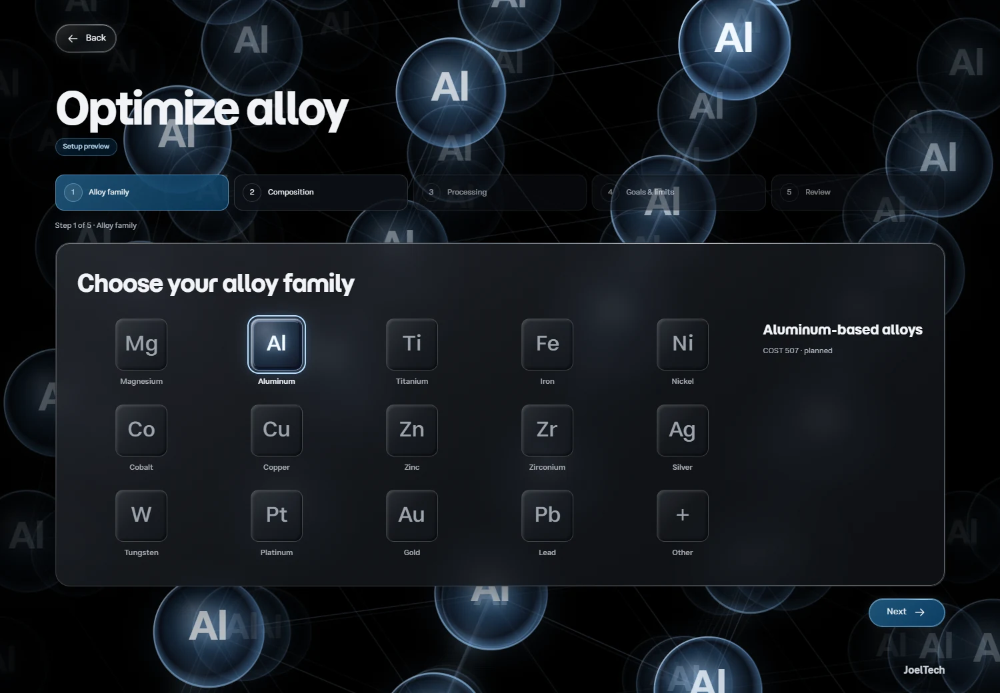
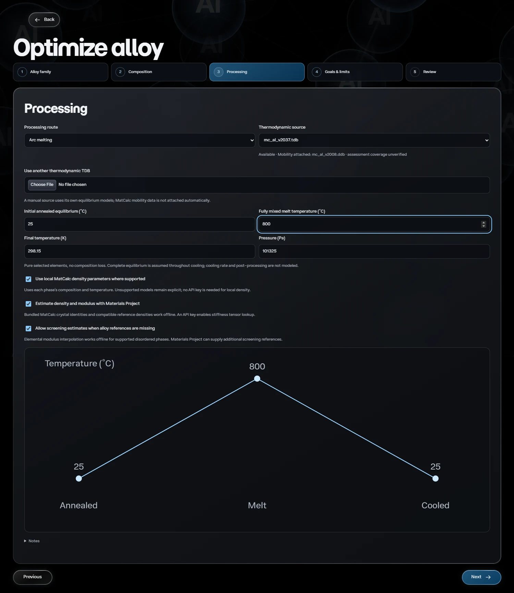

# Rutile

Rutile is a materials modeling project in progress, aimed at extrapolating material properties from CALPHAD thermodynamic equilibrium. The goal is to connect predicted stable phases, their compositions, and their fractions to property models, with explicit assumptions, supporting data, and validation.

The current local web app provides the equilibrium foundation: upload a thermodynamic database, choose two elements, and calculate a binary equilibrium phase diagram with pycalphad. Property extrapolation and calibrated property prediction remain planned. A thermodynamic database alone does not provide validated strength or hardness; those predictions also require material-condition information and suitable models. Solidification, precipitation, and alloy optimization are also future work. See the [roadmap](docs/roadmap.md) for the broader scope and remaining work.


## What you can do

- Import a `.tdb` or `.tbd` thermodynamic database and choose two elements from it.
- Use Auto temperatures to check melting at 10 compositions and plot at least 30 K above the highest result, or set manual limits.
- Set fixed pressure and quality. Watch traced boundaries appear in a live preview, or cancel a running calculation.
- View phase-fraction gradients, labeled boundary curves, and independent sample disagreements.
- Inspect individual points to see which phases coexist, how much of each phase is present, and its composition.
- Export boundaries, independent samples, calculation settings, and source provenance as JSON.
- Configure an aluminum-alloy search through a setup preview, including composition bounds, processing, and property goals and limits. Optimization calculations remain planned.

## Run locally

Install Python 3.12, then clone or download this repository and open its folder. Rutile runs on your computer, and the included example requires no API key.

**Windows**

Double-click [run-rutile.cmd](run-rutile.cmd), or run it from PowerShell. The launcher sets up the environment on the first run and opens Rutile in your browser.

```powershell
.\run-rutile.cmd
```

**macOS**

Use [run-rutile.command](run-rutile.command). Once, open Terminal in the repository
folder and grant the launcher permission to run:

```sh
chmod +x run-rutile.command
```

Then double-click `run-rutile.command` in Finder. Like the Windows launcher, it
creates the Python 3.12 environment and installs dependencies on the first run,
then opens Rutile in your browser. Python 3.12 must already be installed.
You can also run `bash run-rutile.command` from Terminal, with optional arguments
such as `--port 8001`.

**Linux (or manual macOS setup)**

```sh
python3.12 -m venv .venv
.venv/bin/python -m pip install -e .
.venv/bin/python scripts/run_app.py --open
```

Keep the terminal running while you use Rutile at [127.0.0.1:8000](http://127.0.0.1:8000). Press **Ctrl+C** to stop the server.

After updating Rutile, restart the server and reload the browser to load both
backend and interface changes. Interrupted calculations must be started again.

## Explore Re–W

Upload the included [ReW-00Liu-LB.tdb](examples/ReW-00Liu-LB.tdb)
under **Thermodynamic file**. Choose Re and W and keep **Auto** temperature
range, **101,325 Pa**, and **Detailed** quality. The screenshot below uses Manual
limits of **300–4,000 K**. The phase-fraction gradients show
coexisting solids, with liquid always black. Small differences near a boundary
are ignored within the adjustable tolerance while their raw values remain in the
inspector and JSON export. The bundled assessment is an unmodified copy; see
[assessment attribution and license](examples/README.md#rew).


This display example has 4,929 matching checks, seven differences within the
default boundary tolerance, five unverified points, and no unresolved equilibria.
It is not experimental validation. [Calculation methods and limits](docs/phase-diagrams.md)

Many phase diagrams can also be found at [PhaseDiagrams.org](https://phasediagrams.org/).

## Try the included Al–Cu example

1. Start from the title screen and choose **Generate phase diagrams**.
2. Under **Thermodynamic file**, select the included [AlCu-21Kro.tdb](examples/AlCu-21Kro.tdb). Rutile selects Al and Cu automatically.
3. Open **Calculation settings**. Keep **Auto** temperature range or choose **Manual limits** and enter **300–1,400 K**. Leave pressure at **101,325 Pa**, and keep **Detailed** or choose **Fine** for more boundary refinement and independent checks.
4. Click **Generate diagram**. Hover near **10 atomic percent Cu** at **750 K** to inspect the Al-rich FCC phase and the Al₂Cu intermetallic. Click to pin the point or use **Export JSON** to save the calculation.

The renderer traces boundaries, shades mixed fields by molar phase amounts, and
checks independent equilibria (4,941 in Detailed, 10,201 in Fine). Auto uses ten
composition probes, so it can miss narrow melting peaks between probes. Numerical
checks do not establish experimental accuracy; published alloy benchmark
validation remains outstanding. [Calculation methods and limits](docs/phase-diagrams.md) · [Assessment and license](examples/README.md)

## Interface

Drag the crystal on the title screen to rotate it, or use the arrow keys. Open **Settings** to switch to the natural red rutile or reduce motion. [Interface guide](docs/ui-ux.md)

## Alloy setup preview

Choose **Optimize alloy**, then select Al. The setup walks through composition
bounds, processing, property goals and limits, and a review. Only the aluminum
family has a setup preview; COST 507 is a planned source and is not bundled or
connected to this workflow. No property predictions or optimized alloys are
produced yet.



Processing includes creation routes, an editable temperature schedule, and final
cold-work reduction. The values below illustrate the controls; they are not a
validated heat treatment or a simulated thermal response.



## Project and development

The frontend uses HTML, CSS, and native JavaScript. FastAPI serves the interface and manages background jobs, and pycalphad calculates equilibrium. The current workflow covers binary equilibrium. The roadmap tracks published benchmark validation and future modeling features.

- [Frontend](frontend/)
- [Backend](backend/src/rutile3/)
- [Tests](backend/tests/)
- [Documentation](docs/README.md)
- [Roadmap](docs/roadmap.md)
