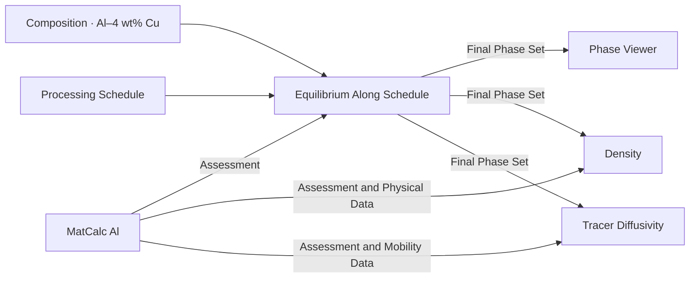

# Alloy Studio workflow plan

Alloy Studio will open a Blueprint-style workflow canvas for designing an alloy, running individual calculations, and inspecting what each calculation needs. A user should be able to run an Al–Cu equilibrium calculation, open its phase table, discover which phase is holding up a density estimate, supply a reference for that phase, and rerun Density using the saved equilibrium result.

This document specifies planned behavior. The node library and field definitions are in the [node catalog](alloy-studio-node-catalog.md). Current equilibrium, transport, and property behavior is documented in [processing methods](processing.md).

## Entry points and starter workflow

- Put **Alloy Studio** in the far-left featured menu tile, **Phase Diagrams** second, and **Settings** after the scientific workspaces. Keep the crystal transition shared by the main menu and scientific screens.
- Open the last project or show **Blank Workflow**, **Al–Cu Equilibrium**, and **Open Workflow** when there is no recent project. The starter opens directly into an editable graph with named inputs, visible wires, and a fit-to-graph view.
- Replace the Create Alloy and Optimize Alloy wizard entries when the starter covers the existing phase calculation and inspection workflow. Put optimization back in the template list once it can execute valid objectives and constraints. Hide the separate Mechanical Properties menu entry. Expose measured test data and supported property methods through workflow nodes as they are integrated.
- Use **Al balance, 4 wt% Cu**, the bundled Al assessment, **101325 Pa**, **298.15 K** initial and cooling target, **1873.15 K** melt, and **21** equilibrium cooling points as editable starter inputs. Supply a separate **Equilibrium at Point** node for a user who wants to calculate one state without a thermal schedule.
- Include **Tracer Diffusivity** in the starter. Its initial selection uses the supported dominant solution phase and exposes the selected phase and actual calculation temperature.
- Show partial property coverage on the Density node if a phase lacks compatible density data. Let the user inspect that phase and optionally add **Resolve Phases** or **Attach Reference** on the density branch. Keep the final Phase Set available to the viewer and transport branch.

## Workspace layout

| Region | Default | Contents and actions |
| --- | --- | --- |
| Top bar | Visible | Project name, save state, undo/redo, **Fit Graph**, **Run Graph**, and panel toggles. Keep the existing shell Back and Settings actions reachable. |
| Canvas | Fills remaining space | Pan, zoom around the pointer or touch midpoint, drag nodes by the header, box-select, and arrange nodes. A user can expand a node to see optional pins or collapse it to the header and connected pins. Drag a file here to import a reusable input. |
| Left project drawer | Closed | Workflows, imported files, saved Phase Sets, and named Material States. Search by name or document kind. Drag a saved item into the graph to create a typed source node. |
| Right Inspector | Open on desktop | Selected node's settings, connected inputs, latest results, coverage, and provenance. Selecting a pin or wire shows both endpoints, type, shape, units where applicable, current artifact, and stale status. Keep the current selection when the drawer closes. |
| Bottom run bar and drawer | Status strip visible, drawer closed | Run state, counted progress where available, and Cancel. Open the drawer for per-node run history, warnings, errors, and elapsed time. Selecting an issue centers and focuses the corresponding node or pin. |
| Preview | Selected in Inspector or pinned to canvas backdrop | Inspect a phase table, chart, microstructure, image, or text output. **Use as Backdrop** pins a single image-capable preview beneath the grid and wires. Show a dimming control so the graph stays readable. |

At widths below 1100 CSS px, let the project drawer overlay the canvas and keep the Inspector collapsible. Below 760 CSS px, open the Inspector and run log as bottom sheets with one sheet visible at a time. Keep a keyboard-accessible node list and **Connect To** action as alternatives to canvas gestures. With touch, a long press on empty canvas opens Add Node. Keep touch targets at least 44 by 44 CSS px and let scrolling work outside the graph. Use the same node and pin names in the canvas and Inspector.

### Visual direction

Use the supplied Unreal Engine Blueprint screenshot as the reference for node anatomy. Its strongest details are raised and bevelled category headers, dark pin rows beneath the header, hollow and filled pins, curved wires that visibly branch, compact inline values, and small utility nodes such as the equality operator. Bring those details into Rutile's existing crystal scene, smoked glass buttons, bright edge highlights, and dark theme.

- Begin with a near-black canvas around `#0B1017`, a fine grid every **20 px** at 100% zoom, and a slightly brighter major line every fifth interval. Fade minor lines as the graph zooms out. Let the crystal show softly behind the grid during entry and settle to a static, low-opacity backdrop during editing.
- Use **14–16 px** corners, a clipped glass gradient, a **1 px** inner top highlight, a thin rim, and a soft cast shadow on node bodies. Use slightly translucent tinted bodies for connected nodes and stronger opacity at text and controls. Keep live backdrop blur on bounded surfaces such as the toolbar, drawers, and node menu. Simulate the node glass with layered gradients so large graphs can pan without per-node blur.
- Use category colors on glossy headers. Inputs and sources use blue, equilibrium and processing use teal, reference and conversion nodes use violet, properties use green, and viewers use slate. Wires and pins keep the data-family colors from the [node catalog](alloy-studio-node-catalog.md#pin-shape-and-color). Keep names and icons visible when colors are hard to distinguish.
- On a fully disconnected node, reduce the saturation of its header and dim the body and shadow. Keep pin and title labels readable. A source with an output connection or a terminal viewer with an input connection counts as connected. Required missing inputs get a hollow pin plus an issue message. Optional unwired pins stay neutral.
- Draw ordinary wires as cubic curves with roughly **2 px** strokes at 100% zoom. Give the stroke a wider invisible hit target. Use a distinct focus outline for the selected node, a stronger wire accent for the selected connection, and optional upstream/downstream highlights when inspecting a branch. Use filled pins for connections and hollow pins for available connections.
- Show short labels and compact inline values on the body. Composition basis, temperature, pressure, and defaults stay visible when they affect interpretation. Put full source hashes, model settings, and failure details in the Inspector. Put **▶** on the top right of a runnable node, with focus text such as **Run Density**.

### Motion and rendering

| Trigger | Planned motion | Settled or reduced-motion behavior |
| --- | --- | --- |
| Enter Alloy Studio | Reuse the shell crystal dive. Bring in the grid and workspace as the camera settles, then reveal the default view of the graph. | Use the existing wide lattice cache during the dive and rebuild settled visible layers at the view's device pixel scale. Show the workspace immediately in reduced motion. |
| Add a node or establish a connection | Use a short **120–180 ms** rise and settle on placement, with a brief edge highlight and a wire draw toward the receiving pin. | Place the node and completed wire immediately when reduced motion is enabled. |
| Hover or focus a node | Let a restrained highlight travel across the header bevel. Lift the shadow subtly. | Keep the focus outline, with static gloss in reduced motion. |
| Open or close a drawer | Slide the glass surface and fade it over **160–220 ms**. Preserve the project camera position and keep the selected node visible. | Show the final layout immediately in reduced motion. |
| Run a node | Animate a small edge or header fill driven by real progress. Use a static pending state for stages with no known count. A completed output can briefly accent the downstream wire. | Always show the stage and real counts when known. Keep pending, complete, and error states readable with motion disabled. |

Reuse the shared shell appearance and motion preferences. Use HTML for node controls and SVG for the first wire layer. Keep world coordinates separate from screen transforms so pan and zoom move the grid, nodes, and wires together. Coalesce geometry updates during drags with `requestAnimationFrame` and redraw only the affected wires when their endpoints change. Raster previews rebuild at the settled display scale. Use browser checks at DPR 1 and 2, with both motion settings. [Current shell and lattice behavior](ui-ux.md)

## Building and running a graph

1. **Add a node.** Right-click empty canvas to open the menu at the pointer with the search field focused. Typing filters labels, categories, and aliases such as “Young's modulus.” Arrow keys and Enter place the selection. Escape closes the menu. Dragging a wire into open space opens the same menu filtered by the originating pin. If the user picks a node, place it and connect the matching pin. Prefer exact matches, then show the available conversion beside each other candidate. Offer a pin picker when the selected node has multiple equally suitable pins.
2. **Connect typed inputs.** Connect one output to any number of compatible inputs. For multiple items, use a collection pin or an explicit Assemble node. Validate kind, shape, quantity, and required basis both when editing and before a run. Keep conversion nodes visible and included in undo/redo. Insert **Solid Fill** automatically for Color → Image. For Material Color → Image, offer **Phase Swatches**, **Select Phase Color**, and **Blend by Visible Area**. Enable the blend only with exposed-area information, compatible lighting, and coverage for the selected phases. Show the missing input when a wire cannot connect.
3. **Edit and inspect.** Inline controls handle common values and the Inspector handles source assignment and model settings. Dragging a wire temporarily highlights compatible targets. Support disconnect, reroute, undo/redo, and keyboard connection. Keep view position, selection, panel state, and style changes out of scientific inputs.
4. **Run to a node.** A node's **▶** runs that node and any missing or stale prerequisites, then stops. Reuse matching upstream results. **Run Graph** evaluates the enabled terminal branches and their dependencies. Viewers refresh on completed inputs. A blocked branch leaves independent branches runnable.
5. **Explain status in place.** Use Draft for a newly placed node, Ready when required inputs exist, Queued and Running during work, Completed for a current result, Stale for a result from earlier inputs, and Canceled or Failed for terminated work. Use **Needs data** for missing prerequisites and **Unavailable** when a calculation runs but its method lacks coverage or applicability. Display stale results with their original inputs and condition. Branch errors should identify the phase, property, file, or field that the user can address.

Determine ordinary calculation order from data wires and reject cycles. Keep sequential processing explicit in the schedule and state connections. Sweeps and optimizers can evaluate a bounded workflow repeatedly through their own scientific node.

## Phase resolution and branch coverage

**Resolve Phases** accepts a raw solver Phase Set or a manually supplied list of labels plus identification evidence. The Inspector shows original model, amount, composition, ordering evidence, assigned identity, available property coverage, and an **Include in this branch** checkbox per row. Prefer reviewed assessment rules and the exact-source inventory. Show provisional or competing matches with their evidence and let the user assign an applicable local record, CIF, Materials Project entry, or manually sourced data. A raw label such as `SIGMA_OLD` stays unresolved until evidence supports an assignment.

Keep the original immutable Phase Set, its TDB source key, and its phase amounts. Record filters and assignments against stable phase instance IDs. For `99.96 mol% FCC_A1 + 0.04 mol% AlCr`, a branch that excludes AlCr carries the original amounts and displays **99.96 mol% included · 0.04 mol% omitted**. The output of Density on this subset is labeled **FCC matrix only**. The full-alloy output requires full applicable volume coverage. Keep the underlying equilibrium solution and mobility model pinned through display edits, structural assignments, and branch selections.

Preserve the local MatCalc path through the graph. A source node supplies pinned assessment, mobility, and physical-data outputs. Existing MatCalc DP and Kawin operations can consume the original solver identity even when the canonical structure or MP reference is still unresolved. Save as much applicable property data as the user has, with an independent source and conditions for each property. The node catalog gives the per-file input rules and fallback order. [Phase registry](phase-registry.md) · [Current source handling](processing.md)

### Alloys outside the MatCalc presets

The current processing request uses the same `family` field for bundled
source selection, composition balance, and the dependent component in
equilibrium and Kawin. Even with a manual TDB selected, that field accepts only
Al, Fe, Mg, Mo, Ni, and Ti. The current graph also compares the composition base
to the selected preset before submitting. In an isolated code probe, relaxing
only the request's family type let the existing equilibrium engine use
`ReW-00Liu-LB.tdb` for W–10 at% Re at 101325 Pa. The engine found a liquid at
3900 K, completed the cooling path, and returned BCC_A2 at 2000 K within its
phase and elemental balance tolerances. This checks the execution path.
Experimental validation requires matched reference data. [Processing request](../backend/src/rutile3/domain/processing.py) · [Re–W assessment](../examples/README.md)

For a custom-alloy path, carry a `base_element` with the composition and let
the wired assessment or an optional MatCalc preset select the source. Validate
all selected elements against the assessment and retain evidence of interaction
coverage separately. Reuse the existing source hash, equilibrium solver, and
mass-balance checks. Add multiple independent addition rows to the Composition
node and use the assessment's declared elements for the picker. The current
processing API already supports up to eight additions. An arc-melt graph needs
a compatible liquid model and a reachable liquid temperature. A point or
solid-start graph would also support assessments intended for solid states.

For custom diffusion, use the actual selected solution phase and explicitly
paired mobility data. The current automatic phase filter and reference-phase
fallback are preset-specific. For density, evaluate any applicable physical
model or phase molar-volume references at the calculated phase compositions
and temperature. Missing companion files or incomplete property coverage
affect their branches while the equilibrium result remains available.
[Kawin adapter](../backend/src/rutile3/engines/processing.py) · [Density and source limits](processing.md)

## Saved workflows and reusable alloy data

Use a common `.rutile` extension for UTF-8 JSON documents with a published schema. Accept the same document with a `.json` extension through in-app import. Use `format: "rutile"` and `schema_version: 1` for the first schema, alongside `kind`, `document_id`, `name`, `created_at_utc`, `payload`, and `attachments`. Route imports by the validated header and schema. Define three initial document kinds.

| Kind | Required payload | Behavior on open or drop |
| --- | --- | --- |
| `workflow` | Node IDs and versioned operation IDs, settings, edges by node and pin ID, project-level inputs, and optional view state and saved result references. | Open the graph and show any missing source files or result artifacts. |
| `phase_set` | Conditions, phase instances, original fraction basis, assessment and model identity, selected or excluded instances, available property values, and provenance. | Create a Phase Set input node with a purple output. Values saved with the file can be inspected and reused offline. Recalculation asks for any missing original data source. |
| `material_state` | Composition, condition, phase set, chronological processing history, available microstructure, associated property results, and source references. Include a parent state ID when derived from another stage. | Create a Material State input node. The same object can feed a heat-treatment node, property branch, or visualization. |

Use immutable artifact IDs for the outputs referenced in a document. Keep provenance, basis, condition, and source checksums with saved values. Include parser and model versions in reproducible outputs. Large voxel maps, images, or raw engine results may use companion files identified by document-relative path, content type, byte size, and SHA-256. Offer a bundled export later when there are real large-data use cases. Use CIF for exchanging a known crystal structure and consider DREAM3D for exchanging spatial microstructure fields. Expose the applicable source terms when a file is included. [Core CIF dictionary](https://www.iucr.org/resources/cif/dictionaries/cif_core) · [DREAM3D file specification](https://www.dream3d.io/nx_reference_manual/html/Concepts/DREAM3DFileSpecification.html)

Show a preview of the imported type and any missing attachments. Resolve only permitted document-relative attachments or catalog items by checksum. Validate input size, structure, and schema version before storing it. Use atomic writes in the workspace. Associate `.rutile` through a small Windows launcher after import works. The launcher should start or reuse the loopback server and send the validated file through the same import path as a dropped file. Double-click opens the file or shows its typed input. Running a graph stays an explicit action. [Windows file type registration](https://learn.microsoft.com/en-us/windows/win32/shell/fa-file-types)

## Implementation boundaries

| Layer | Work |
| --- | --- |
| Frontend | Add a native JavaScript workspace under `frontend/src/js` and graph styles under `frontend/src/styles`. Reuse the shell, theme, motion settings, existing chart and result renderers, and browser accessibility conventions. Keep graph editing, drawing, and reading node results separate. |
| Domain | Define versioned Pydantic schemas for graph, pins, artifacts, states, and results. Publish one operation catalog with labels, stable IDs, versions, pin contracts, settings schema, and availability. Use it for editor compatibility and backend validation. |
| Services and API | Define a service that validates and schedules selected graph targets, resolves sources, and records graph revisions. Provide endpoints for catalog, graph validation, import, save/open, run, status, cancellation, and result retrieval. Keep I/O response schemas and HTTP error translation in `api/`. |
| Scientific adapters | Extract the selected-state equilibrium, property, and transport operations from the existing pipeline at the scientific boundary. Have both the graph and legacy processing route call those operations during migration. Keep each operation callable in tests and batch use without the UI. |
| Jobs and storage | Run CPU-bound nodes through the existing job manager and subprocess layer. Preserve process-tree cancellation, worker exit on coordinator loss, counted progress, source snapshots, and one native BLAS/OpenMP thread per process. Keep managed source imports and run outputs in the existing workspace storage layout. |

Build the cache key from operation and model versions, normalized scientific settings, input artifact hashes, and resolved source hashes. Pin an execution to a graph revision and its inputs. When an edit changes scientific inputs, mark affected descendants stale and keep the cached values available for inspection. Late results from an older revision attach to the submitted run. Write terminal results atomically before publishing completion. Resume a saved graph with completed results where their artifacts are available and start a new run for interrupted work. [Existing application architecture](architecture.md)

### Agent access

The Inspector is the first entry point. **Find reference** on a blocked pin gives the agent the phase instance, actual composition, applicable structure evidence, property, required units, and condition. Return candidate sources with record IDs or links, matching evidence, applicability limits, and reasons a candidate was rejected. Put any proposed assignment, conversion, or graph edit in a reviewable change. Use the same operation schemas and validation for UI and agent calls. A candidate can become a typed reference record when selected. Keep optional Materials Project credentials in the existing backend session path.

## Build order and acceptance

| Milestone | Deliverable | Acceptance |
| --- | --- | --- |
| 1. Canvas and types | Main-menu entry, native editor, node catalog, graph save, and draft starter. | Keyboard and pointer can add, select, move, connect, and remove nodes. Dragging a Phase Set wire to empty space filters the menu and connects the chosen compatible pin. A Color → Image drop inserts Solid Fill. A Material Color → Image drop offers the three explicit conversions and identifies required data. At 390, 768, and 1440 CSS px, verify drawer access, no clipped controls, visible focus, and sharp settled rendering. |
| 2. Working equilibrium starter | Versioned graph runner, file/source nodes, equilibrium, phase inspection, and existing MatCalc density and tracer adapters. | Run the Al–Cu graph from pinned files with the Materials Project key absent. Verify phase and elemental balances, show coverage for incomplete density, and retrieve a completed result after reopening. Re-run Density after changing its reference and reuse equilibrium. Edit composition and show dependent results stale. Cancel a long job and retain earlier completed artifacts. |
| 3. Sharing and resolution | `.rutile` import/export, typed source nodes, phase assignment and filtering, and comparison summaries. | Export a Phase Set, open in a clean workspace, drop onto a canvas, and use it without rerunning equilibrium. Check omitted phase fractions, unresolved identities, duplicate phase names with different compositions, and a missing density reference. Verify unit conversion for equivalent values and a scoped check for an extreme strength result. |
| 4. Processed material states | Solidification, kinetics, and mechanistic property models added individually as applicable data become available. | Transfer from an explicitly selected starting state. Compare grain, precipitation, and property outputs with independent condition-matched benchmarks. Reopening a state preserves model parameters, evidence, and uncertainty. |
| 5. Appearance and design | Phase color, selected etch models, sweeps, and bounded optimization. | Reproduce benchmark reflectance-to-color conversions. Compare polished previews using supported phase data. Validate an etch model against measured relief for a matched bath, alloy, and exposure. Show which candidates are infeasible or unavailable in an optimization run. |

For the tracer node migration, add a regression where the cooling target and the final anneal or quench setpoint differ. Current Kawin processing reads composition from the final phase state and temperature from the original cooling target. The node must take both from its connected state. Test the explicit reference-only fallback independently from transport in a phase identified as present. For Density, check that a missing intermetallic volume preserves per-phase results and full-alloy coverage, and that omitting a trace phase produces a labeled subset result. [Current tracer implementation](../backend/src/rutile3/engines/processing.py) · [Density coverage methods](density-benchmarks.md)
